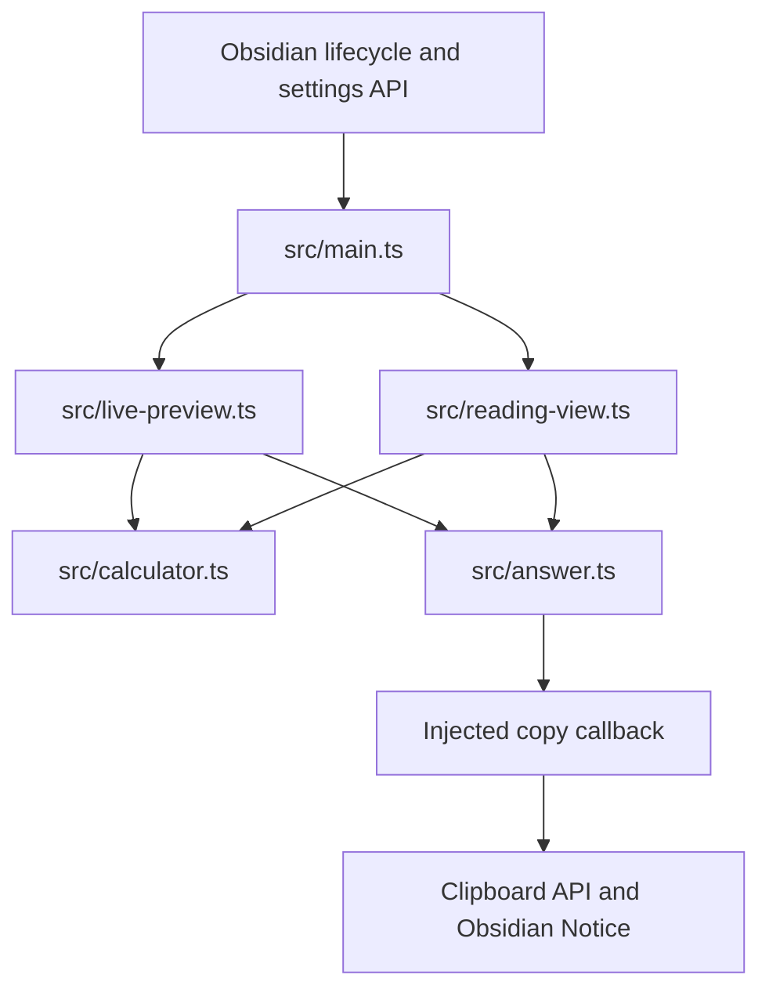

# Note Calc Technical Documentation

This document describes the current repository implementation. The [README](README.md) covers setup and everyday development. File paths below are relative to the repository root.

## 1. System overview and evidence status

Note Calc is an Obsidian plugin with two rendering adapters around a shared synchronous arithmetic parser. It reads note text or rendered Markdown sections, computes a formatted answer, and adds visual UI without persisting answers into the note.

| Status | Meaning and current scope |
| --- | --- |
| **Implemented** | Code is wired into `NoteCalcPlugin.onload()`: settings, the CodeMirror extension, the Reading view postprocessor, and clipboard/notice callbacks. |
| **Test-covered** | `tests/regression.ts` contains calculator cases, DOM fixtures, CodeMirror selection/copy tests, and an interactive fixture. Existence of a test does not establish a successful run. |
| **Verified in this task** | During this documentation update on 2026-11-03: source/configuration inspection and static document consistency checks. No build or behavioral tests were run for this documentation task. |
| **Externally unverified** | Actual Obsidian desktop/mobile behavior, minimum-version compatibility, OS clipboard policy, host Markdown parsing, vault synchronization, and GitHub release execution. |
| **Experimental / Inactive** | The browser test/demo page is outside the plugin runtime. No separate experimental production path or feature flag is declared. |
| **Planned / Not implemented** | Recommendations in section 15 only; they are not completed features or an existing delivery commitment. |

The plugin itself has no backend, provider adapter, network request, streaming/polling loop, or background worker. Release automation is a separate development path.

## 2. Architecture, dependencies, and ownership

`src/main.ts` is the composition root. It loads settings, constructs a shared clipboard callback, and registers the two adapters with Obsidian. The editor receives a settings getter, a Live Preview predicate using `editorLivePreviewField`, and the clipboard callback. Reading view receives the current precision, postprocessor context, and the same callback.



The parser depends on neither Obsidian nor the DOM. `answer.ts` depends on DOM APIs and an injected callback, not the Obsidian runtime. `live-preview.ts` imports CodeMirror but does not directly import Obsidian; `reading-view.ts` imports the postprocessor context as a TypeScript type only.

Obsidian owns registered extensions, postprocessors, and the setting tab. CodeMirror owns view-plugin instances and their decorations. Reading view creates DOM nodes in the supplied container. Answer listeners are attached to their elements; the plugin registers no global answer listener, timer, or custom unload routine. Widget equality compares value, spacing, selected state, and callback identity to allow CodeMirror to reuse equivalent widgets.

## 3. Project structure and components

| File or directory | Important components and responsibilities |
| --- | --- |
| `src/main.ts` | `NoteCalcPlugin`, `NoteCalcSettingTab`, settings defaults, clipboard integration, and host registration. |
| `src/calculator.ts` | `CalculationMatch`, `CalculationOptions`, `calculateLine()`, expression detection, `Parser`, and `formatNumber()`. |
| `src/live-preview.ts` | `createNoteCalcLivePreviewExtension()`, `OperatorWidget`, `AnswerWidget`, visible-line decorations, syntax exclusions, and copy handling. |
| `src/reading-view.ts` | `renderReadingViewCalculations()`, `TextPart`, `RenderedLine`, source matching, and DOM Range replacement. |
| `src/answer.ts` | `CopyAnswer` callback type and `createAnswerElement()`. |
| `styles.css` | Answer selection/focus styling, selected-answer highlighting, and multiplication visibility in the editor. |
| `tests/regression.ts` | Browser-only assertions, rendered-Markdown fixtures, CodeMirror views/events, and interactive copy demo. |
| `tests/regression.html` | Loads the generated test bundle and copied production stylesheet; displays results and demo. |
| `main.js` | Generated production plugin bundle; editable implementation lives in `src/`. |
| `package.json`, `package-lock.json` | npm scripts, declared versions, and the locked dependency graph. |
| `esbuild.config.mjs`, `tsconfig.json` | Bundle and TypeScript configurations. |
| `manifest.json`, `versions.json` | Plugin identity and declared minimum Obsidian versions. |
| `.github/workflows/release.yml` | Tag-triggered release configuration. |
| `LICENSE`, `.gitignore` | Project license and exclusions for dependencies, editor/vault settings, logs, and OS files. |

No native application project, Xcode scheme, entitlement, backend configuration, environment example, or extra script directory is present in the inspected repository.

## 4. Data flows

### Live Preview

1. CodeMirror creates the view plugin, which builds decorations for visible document ranges.
2. Each visible line is passed to `calculateLine()` with the current precision.
3. A syntax-tree check near the line start can exclude the line.
4. Eligible formulas receive a line class and multiplication-operator decorations. In Live Preview, an `AnswerWidget` is inserted at the position immediately after `=`.
5. Document, viewport, selection, or Live Preview mode changes rebuild decorations. The current settings getter is consulted on rebuild.

Source mode can still receive expression/operator styling, but it receives no generated answer widget and the plugin's custom copy handler returns without handling the event.

### Reading view

1. The registered Markdown postprocessor calls `renderReadingViewCalculations()` with the rendered container and section context.
2. `collectLines()` snapshots text-node slices into complete lines. Block elements, text newlines, and `<br>` delimit lines; excluded inline content marks a line as ineligible.
3. Lines ending in `=` are matched against candidate source lines from `getSectionInfo()`. Candidate normalization removes limited blockquote/list/task/heading markers and considers pipe-separated table cells.
4. `matchSource()` constructs a source-to-rendered offset map, allowing only missing `*` characters. Matching candidates must also parse successfully.
5. If source matching fails on an emphasized line, the renderer skips it. Otherwise it calculates the matched source or the complete rendered line.
6. Working backwards through the snapshot, a DOM Range replaces the expression through the line end with literal formula text and an answer element. Prefix content before the expression is retained.

Existing answer elements make the collected line ineligible, preventing ordinary repeated postprocessing from appending another answer. Source matching is a conservative heuristic, not a replacement Markdown parser.

### Copying

The shared answer element displays `answerPrefix + answer`, but its callback receives only `answer`. Clicking, or pressing Enter/Space while focused, invokes the callback. The plugin calls `navigator.clipboard.writeText()` and shows an Obsidian Notice for success or failure.

For Live Preview copy events with `clipboardData`, the handler first checks for a native selection wholly inside one answer widget. It copies that selected text directly. Otherwise, for nonempty editor selection ranges, it scans original document lines and inserts each answer into the outgoing text only when the selection covers the complete detected expression through `=` and the line passes exclusion checks. Multiple ranges are joined with the editor's line separator. It writes plain text and prevents the default copy only when it handled selected answer text or added an answer.

Empty selections, partial expressions, unavailable `clipboardData`, Source mode, and unchanged copy results fall back to host behavior. The plugin does not override Cut. Reading view relies on native text selection/copy for complete formulas.

### Settings persistence

`loadSettings()` awaits `loadData()` and shallow-merges the returned object over defaults. The dropdown converts its selected value with `Number()` and calls `saveSettings()`, which awaits `saveData()` and requests `workspace.updateOptions()`. There is no plugin-owned note write, database, cache, or cloud synchronization path.

## 5. Core interfaces

| Interface | Inputs | Outputs and dependencies |
| --- | --- | --- |
| `calculateLine(text, options)` | One text line and `{ decimalPlaces }`. | `CalculationMatch` or `null`; synchronous and independent of DOM/host APIs. |
| `createNoteCalcLivePreviewExtension(getDecimalPlaces, isLivePreview, copyAnswer)` | Three callbacks for precision, mode, and answer copying. | CodeMirror view-plugin and DOM-event-handler extensions. |
| `renderReadingViewCalculations(container, decimalPlaces, context?, copyAnswer?)` | DOM container, precision, optional section lookup, and optional copy callback. | Mutates rendered DOM only; returns `void`. |
| `createAnswerElement(doc, answer, prefix, copyAnswer?)` | Owner document, formatted value, spacing, and optional callback. | A selectable `HTMLSpanElement`; callback omission leaves a plain answer element, as used by some fixtures. |
| `CopyAnswer` | Formatted answer string. | `void`; the composition root owns the asynchronous clipboard operation and its notices. |

Optional callback/context parameters support renderer use in fixtures; normal plugin registration supplies both. They do not define a separate user-facing runtime mode.

## 6. Data models and state

`CalculationMatch` contains `answer`, `answerPrefix`, `expressionFrom`, `expressionTo`, `equalsFrom`, and `equalsTo`. Offsets refer to the original input string, allowing adapters to retain surrounding text. The currency symbol is already part of `answer`; `answerPrefix` is spacing, not currency metadata.

`NoteCalcSettings` contains only `decimalPlaces: number`. The default is `2`, and the UI offers `0`, `1`, `2`, `3`, and `4`. Loaded data is not schema-validated or clamped, so malformed persisted values can affect formatting. The parser's catch boundary turns formatting errors into `null`, rather than showing a setting-validation message.

The parser stores a source cursor and one currency symbol per parse. Reading view's `TextPart` stores a text node plus slice boundaries; `RenderedLine` stores parts, combined text, exclusion state, and emphasis state. The editor view plugin retains only its current `DecorationSet`.

There is no persistent answer history, entity/DTO layer, provider boundary, cache version, settings migration, Keychain storage, or database schema. Obsidian controls the backing location and synchronization of data saved through its plugin API; this repository does not validate those host behaviors.

## 7. Important logic and edge cases

### Formula detection

`CALCULATION_LINE` requires an ending `=` with optional surrounding whitespace. After trimming the expression end, detection scans possible starts from left to right and accepts the first suffix that parses to a finite value. A suffix after leading text must contain an operator; a full-line numeric expression may be accepted without one.

A boundary heuristic prevents starting immediately after currency symbols, numeric/comma/operator tails, or numeric exponent prefixes. This avoids tested cases where malformed grouped input would otherwise yield a valid-looking tail. It is not a general natural-language tokenizer or a proof that every malformed line is rejected in its entirety.

### Arithmetic

The recursive-descent sequence is additive → multiplicative → unary → power → primary/number. Multiplicative operations are left-associative. Power recursively parses a unary exponent, making powers right-associative and permitting signed exponents. Unary minus applies outside power parsing, so `-2^2` follows `-(2^2)`.

Operators use JavaScript `Number` semantics. `%` computes remainder. Non-finite final values are rejected. Parentheses require a closing delimiter, and parsing must consume the complete candidate expression. There is no `eval()`, variable environment, function registry, arbitrary-precision arithmetic, or explicit recursion/length limit.

### Numeric grouping and currencies

The parser first reads a numeric token that can include commas, then validates the entire token. A grouped integer begins with 1–3 digits and has one or more three-digit groups. Decimal and exponent digits cannot contain commas. Only after validation are commas removed for `Number()` conversion.

Before each numeric operand, the parser accepts one Unicode currency-symbol character matched by `\p{Sc}` and optional following whitespace. Every currency symbol in an expression must match the first. Symbols are display annotations, not units or exchange-rate inputs. The sign is parsed before the symbol (`-¥1,000`); the formatted negative answer puts the symbol first (`¥-1,000.00`), so that displayed negative form is not guaranteed to round-trip as numeric input.

### Formatting

Values with magnitude below `1e-12` are normalized to zero. `toFixed(decimalPlaces)` rounds the result, then a regular expression adds commas to the integer string. The currency symbol is prepended separately. Output is not locale-aware and retains JavaScript floating-point/large-number formatting limits.

### Exclusions and rendering heuristics

Live Preview resolves the syntax node at approximately the line's first character and checks ancestor names for `code`, `math`, `frontmatter`, `yaml`, `hashtag`, `hmd-internal-link`, and `url`. It does not inspect every expression position independently.

Reading view excludes `CODE`, `PRE`, `SCRIPT`, `STYLE`, `MATH`, and `A`, plus math/frontmatter/answer classes. It checks excluded ancestors of the container and skips lines containing excluded inline elements. Its block-element list is explicit rather than derived from CSS layout.

Inactive Live Preview lines get separate `*` widgets to compensate for host emphasis rendering; active lines use marks over source operators. Selection changes control those decorations and answer highlighting. More complex host syntax, folded ranges, tables, themes, and other plugins require host validation.

### Interaction guards

Answer spans have an accessible label, button role, tab stop, and copy/select tooltip when a callback exists. Pointer movement greater than four pixels marks the gesture as a drag. Click-copy is skipped after dragging, when the document selection is noncollapsed, or when click detail exceeds one. Enter/Space prevents default and stops propagation before copying. These are implemented input rules; they are not a verified accessibility or mobile-gesture certification.

## 8. External dependencies and versions

All direct packages are declared under `devDependencies`. Their role at runtime differs: Obsidian and imported CodeMirror modules are external to the bundle and supplied by the host; build tools run in the developer environment.

| Package | `package.json` declaration | `package-lock.json` version | Role |
| --- | --- | --- | --- |
| `obsidian` | `1.13.1` | `1.13.1` | API typings/development package; runtime integration is supplied by Obsidian. |
| `@codemirror/language` | `^6.10.8` | `6.12.3` | Host syntax-tree access; bundled into the standalone test page. |
| `@codemirror/state` | `6.5.0` | `6.5.0` | Editor state, selection, and decoration ranges. |
| `@codemirror/view` | `6.38.6` | `6.38.6` | Editor views, plugins, widgets, and events. |
| `@types/node` | `^22.15.3` | `22.19.21` | Development type declarations, not an installed Node runtime version. |
| `esbuild` | `^0.25.3` | `0.25.12` | Bundler; locked package requires Node.js `>=18`. |
| `tslib` | `^2.8.1` | `2.8.1` | TypeScript helper support; `importHelpers` is enabled. |
| `typescript` | `^5.8.3` | `5.9.3` | Type checking; locked package declares Node.js `>=14.17`. |

The lockfile also records transitive Lezer, DOM/style helpers, Obsidian-package dependencies, and platform-specific optional esbuild binaries. These entries are not evidence that the application uses each package directly. For example, the bundler external list includes Electron and additional CodeMirror modules, but the plugin source does not directly import all of them.

There is no third-party API adapter, official/unofficial remote endpoint selection, or provider credential configuration in the runtime source. The system Clipboard API is host-provided. Dependency fetching and GitHub release automation are external development services, not plugin calculation dependencies.

## 9. Configuration, build, and release

| Configuration | Actual behavior |
| --- | --- |
| `manifest.json` | ID `note-calc`, name `Note Calc`, version `1.1.1`, declared minimum Obsidian `1.5.0`, mobile eligibility via `isDesktopOnly: false`. |
| `versions.json` | Maps `1.0.0`, `1.0.1`, and `1.1.1` to minimum app version `1.5.0`; does not establish tested compatibility. |
| `package.json` | Only `dev` and `build` scripts; package entry `main.js`; no runtime engine/npm pin or install/test/lint/format script. |
| `package-lock.json` | Lockfile version 3; use `npm ci` for reproducible dependency resolution. |
| `tsconfig.json` | Strict checking, `noUnusedLocals`, ES2018 target/library plus DOM, ESNext modules, Node module resolution, helper imports, and `src/**/*.ts` inclusion. Tests are outside this include. |
| `esbuild.config.mjs` | Bundles `src/main.ts` to CommonJS `main.js`, target ES2018, tree shaking, generated-file banner, and host/Node module externals. |

`npm run dev` runs esbuild watch mode with inline source maps and without TypeScript checking. `npm run build` first invokes `tsc --noEmit --skipLibCheck`, then runs esbuild with the `production` argument, enabling minification and disabling source maps before disposing its context. Only `main.js` is generated. `manifest.json` and `styles.css` are existing files copied alongside it for installation/release.

The release workflow triggers on any pushed tag (`"*"`), uses `ubuntu-latest`, `actions/checkout@v4`, and `actions/setup-node@v4` with Node.js 22 and npm caching. It runs `npm ci` and `npm run build`, requests provenance attestations with `actions/attest-build-provenance@v2`, and configures `softprops/action-gh-release@v2` to upload the three plugin assets and generate release notes. Permissions are `contents: write`, `id-token: write`, and `attestations: write`.

There is no configured browser-test CI job, tag/manifest version-consistency check, ordinary push/PR build job, or automated vault installation. Workflow configuration does not verify that a release or attestation exists. No workflow was triggered or queried during this task.

No environment variables, `.env` example, API keys, certificates, native signing settings, entitlement, backend mode, or runtime feature flag is declared. The `production` command argument changes bundle output, not product functionality.

## 10. Error handling and logging

Parser/token/parenthesis errors are internal `Error` objects; `calculateLine()` catches them and returns `null`. Invalid candidates, non-finite results, missing section matches, and excluded rendering contexts generally produce no answer or error UI. There is no structured diagnostic/error model or parser log.

The clipboard callback wraps access in a promise chain, including synchronous access failures. It shows `Answer copied` or `Could not copy answer. Select the text and copy manually.` No retry, backoff, timeout, or error-detail logging is implemented. Each user interaction starts its own write; there is no ordering/cancellation or stale-request guard.

Settings load/save awaits the host APIs without a custom catch/recovery layer. Build errors propagate through the shell script's `&&` chain; esbuild uses informational logging. The browser test harness catches individual assertion failures and prints them in the page/title, but does not provide a CLI test-runner exit code.

## 11. Security and privacy boundaries

The calculator uses its own parser rather than dynamic code execution. Answer rendering uses `textContent` and DOM text nodes; it does not insert note-derived answer HTML. `innerHTML` appears in test fixtures using test-authored input, not in the production answer-rendering path.

The plugin has no explicit network client, authentication, token/secret storage, telemetry, or note-content logging. It writes settings through Obsidian and writes selected/generated text to the OS clipboard only on user copy interactions. Once copied, that text is subject to the operating system and other clipboard consumers; the plugin does not clear or encrypt the clipboard.

There is no plugin-owned database protection, TLS transport, certificate pinning, WebView, Keychain integration, App Attest, APNs path, or cloud-sync implementation to validate. The manifest does not define a granular permissions model. Host permissions, Clipboard API availability, and vault storage/sync behavior remain external responsibilities and were not verified here.

The optional local browser page can run without a backend provider after dependencies and assets are available. Its interactive demo intentionally invokes the Clipboard API. The documented server binds only to loopback and must be stopped manually. It is not started by the production plugin or build script.

## 12. Testing and task validation

### Existing coverage: Test-covered

`tests/regression.ts` uses a small browser assertion helper, not a separate test framework. Its cases cover arithmetic/formatting, currency and comma grouping, invalid examples, Reading view source recovery/exclusions/idempotency, selectable answers, click/keyboard callbacks, drag guards, actual CodeMirror views, whole/partial/multiline copy, native answer selection, Source mode, and Cut.

Reading fixtures provide rendered HTML and a section-info stub; they do not invoke Obsidian's Markdown renderer. Editor fixtures inject a boolean mode predicate and copy callback; they do not load Obsidian or its real syntax tree. Most clipboard assertions inspect synthetic events or recorded callbacks rather than the operating system clipboard. The interactive demo permits additional real gesture/clipboard checks, but is not an automated assertion of host behavior.

The harness requires a browser and generated `regression.js` beside its HTML and copied production CSS. It is not part of the plugin bundle or release workflow. Setup and execution commands are in [README browser checks](README.md#optional-browser-regression-page). Dependency installation requires package access unless already cached; the calculator/fixture execution has no remote-provider requirement.

### Available static checks

From the repository root with dependencies installed:

```bash
npx --no-install tsc --noEmit --skipLibCheck
npx --no-install tsc --noEmit --skipLibCheck --strict --target ES2018 --moduleResolution node --module ESNext tests/regression.ts
```

The first checks the configured source tree. The second explicitly includes the browser test entry point and its imports. Neither runs behavioral assertions or regenerates `main.js`. They are documented manual invocations of installed tools, not additional package scripts.

### Verified in this documentation task

The documentation-only update inspected all repository source modules, test sources, manifests, package declarations and lockfile metadata, TypeScript/esbuild settings, release configuration, license, and existing documents. Static validation checks document fences, relative links/paths, configuration/version consistency, credential-shaped text/personal paths, and preservation of files outside the two approved documents.

No dependency installation, build, type-check command, browser test, server, Obsidian launch, vault installation, network query, or release was performed during this documentation task. Earlier conversation results are not used as evidence of a fresh run. Desktop/mobile behavior, host integration, minimum-version compatibility, clipboard policy, iCloud propagation, CI execution, and publication remain **Externally unverified** here.

## 13. Known limitations and technical debt

- **Numeric precision:** `Number`/`toFixed()` rounding and large-number output limitations; no decimal-money arithmetic or locale-aware parsing/formatting.
- **Detection:** suffix scanning and repeated parse attempts are heuristic; there is no explicit input-size/recursion bound or performance benchmark for long invalid expressions.
- **Currency model:** one symbol per expression without units/conversion; negative formatted currency is not a guaranteed input round-trip.
- **Markdown recovery:** limited prefix removal, literal pipe splitting, and removed-star matching do not cover arbitrary nested/escaped Markdown or all tables. Missing source information can suppress emphasized calculations.
- **Host coupling:** Live Preview depends on Obsidian mode fields and syntax-node names. Exclusion is based near line start. Fixtures do not reproduce host parsing, mobile selection, themes, folded ranges, or competing extensions.
- **Settings:** no persisted-data validation, schema version, migration, or explicit existing-Reading-view refresh mechanism when precision changes; the setting path requests a host options update.
- **Copy behavior:** generated values are appended only for complete editor expression selections. Missing clipboard event data falls back to host handling. Cut and empty-selection copies are not enhanced. Clipboard requests have no coordination or retries.
- **Validation automation:** browser tests are manual, not run in CI, and lack a CLI failure status. Host clipboard/notice failures, actual Markdown parsing, multi-cursor interactions, and minimum app-version compatibility are not comprehensively established by fixtures.
- **Release metadata:** version `1.1.1` appears in package/manifest/lock metadata; the workflow does not check alignment with pushed tags. SDK typings `1.13.1` do not prove runtime compatibility with declared minimum app `1.5.0`.

## 14. Design decisions and trade-offs

- **Visual answers:** keeping answers in decorations/rendered DOM avoids note edits and keeps original Markdown as the arithmetic source. Live Preview therefore needs custom copy handling to export generated text.
- **Shared computation and answer UI:** one parser/formatter and one answer-element factory keep both adapters consistent, while injected callbacks keep clipboard/Obsidian integration at the composition root.
- **Local synchronous calculation:** arithmetic needs no provider or network state, but parsing and decoration work runs on the UI thread without a worker or explicit capacity limit.
- **Conservative Reading view recovery:** requiring a matching source candidate for emphasized lines favors skipping uncertain formulas over calculating text with swallowed operators. This is a localized fail-closed rule, not comprehensive validation of all Markdown.
- **Plain-text copy output:** selected formula copying does not persist generated values or provide a rich HTML export. Leaving Cut to the host preserves source-editing semantics.
- **Host-supplied modules:** externalizing Obsidian/CodeMirror reduces bundle ownership but ties behavior to host module/API compatibility. The standalone test page bundles its own locked CodeMirror packages, so it cannot establish every host-version interaction.

## 15. Future development

The following are **Planned / Not implemented** recommendations derived from current extension points, not features promised by existing configuration:

- Add settings schema/range validation in `loadSettings()` and explicit refresh tests for both renderers, preserving the single composition root and no-note-write behavior.
- Add a browser test runner and CI coverage around `tests/`, followed by real Obsidian desktop/mobile and minimum-version checks. Keep fixtures labeled separately from host integration evidence.
- Strengthen expression-boundary and Markdown-source matching behind `calculateLine()` and the Reading view adapter; retain raw input offsets, code/link exclusions, and conservative handling of uncertain source recovery.
- Introduce an explicit numeric/locale policy inside the shared parser/formatter if decimal precision or currency round-tripping is required; both adapters should continue to receive identical formatted results.
- Improve copy/gesture accessibility and clipboard-failure tests through the injected callback and shared element factory, without introducing background clipboard reads or storing note-derived values.
- Validate version alignment and execute regression checks in release automation before publication. Any added external service or credential path would need an explicit new configuration/security boundary; none exists today.
